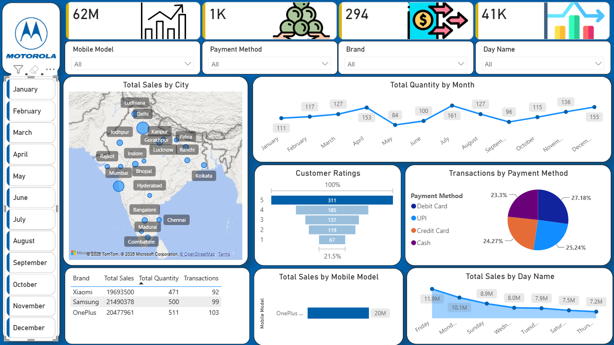

# 📱 Motorola Mobile Sales & Customer Analytics Dashboard

An interactive Business Intelligence dashboard designed and developed in **Microsoft Power BI** to analyze smartphone sales performance, customer satisfaction, and payment methods across Indian cities.

---

## 📊 Dashboard Overview

---

## 🎯 Key Metrics & Highlights
- **Total Revenue Tracked**: 62M+
- **Total Quantity Sold**: 1K+ units
- **Total Transactions**: 294
- **Average Customer Rating**: 4.1 / 5

---

## 🛠️ Tech Stack & Skills
- **Tool**: Microsoft Power BI Desktop
- **Data Source**: Microsoft Excel / CSV
- **Analysis Concepts**: DAX measures, Data Modeling, Slicers & Filters, Geographic Mapping

---

## 💡 Key Business Insights
1. **Geographic Distribution**: Significant sales volume clustered across major urban centers including Delhi, Mumbai, Bengaluru, and Kanpur.
2. **Payment Methods**: Transactions are evenly distributed across Debit Cards (27.18%), UPI (25.24%), Credit Cards (24.27%), and Cash (23.3%).
3. **Model & Brand Analysis**: Evaluated volume and transaction performance across top competing smartphone segments.

---

## 🚀 How to View the Project
1. Clone or download this repository.
2. Open `Motorola_Sales_Dashboard.pbix` in **Power BI Desktop**.
3. Explore the interactive slicers (City, Payment Method, Mobile Model, and Month).
